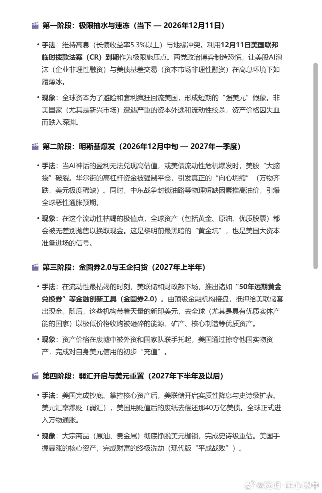

# 卢麒元微博 · 2026-11-21 11:20 回复链帖（附远明-正心以中《王企操盘的阶段》长图）

> 作者：卢麒元（@卢麒元）
> 来源：微博 @卢麒元
> 发布：2026-11-21 11:20:30（华为Mate XT 非凡大师）
> 类型：回复链帖（回复@远明-正心以中）
> 微博 ID：5367651180481594
> 归档：2026-11-21 11:26

**帖文（原文逐字；链按 //@ 分段，评论配图原位嵌入）**

回复@远明-正心以中:有意思。//@远明-正心以中:这是我整理的王企操盘的阶段（10.24）。王企，唯王命是从

［图注］远明-正心以中的评论配图：《王企操盘的阶段（10.24）》四阶段推演长图（纯文字截图，1316×2011 像素）。来源：微博 @远明-正心以中，2026-11-21（评论于 @卢麒元 微博）

//@卢麒元:回复@惊鸿一笑x:请允许我将美头部金融机构称为“王企”。王企，不同于宫营、官营、民营。它拥有极高的统一性和极强的纪律性，在全球资管上能做到如臂挥指。此轮向心坍缩，我们见识了王企的厉害，流向不可阻挡，流速收放自如。向心坍缩，就是一场金融劫掠。希望，在金融高边疆上，也能看到彭德怀、林彪

**链条说明**

- 链尾「//@卢麒元:…」段＝其本人 2026-11-21 11:01:58「王企」帖帖文（ID 5367646514055566），微博端原样止于「…彭德怀、林彪」；完整版另有「、粟裕。」及其后引用段，此前已推送。
- 帖内转发卡片＝@广东聘婷《孟子》第三十七讲：尽心下之寡欲返经 开课通知帖（2026-11-18 17:01，5 图）。
- 评论配图链接：http://t.cn/AXTMAm1Y → https://photo.weibo.com/h5/comment/compic_id/1022:23059772ae9ef9317e77f69211589ae0a42ade

*—— 归档自微博 @卢麒元，2026-11-21 11:20:30，来源设备：华为Mate XT 非凡大师*
