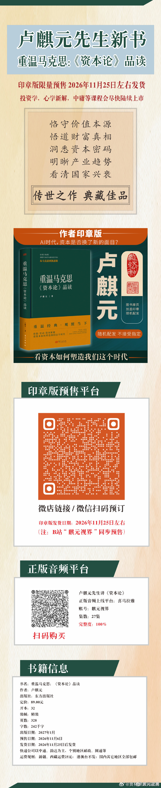

# 卢麒元回复网友预订留言（回复链帖）

> **发布方**：微博 @卢麒元
> **发布**：2026-11-09 09:47:08 · 来源：华为Mate XT 非凡大师（ID 5363279028555332）
> **互动**：转发 1 · 评论 6 · 赞 44（抓取时快照 2026-11-09 09:56:32）
> **链接**：https://m.weibo.cn/detail/5363279028555332
> **配图**：转发对象配图 1 张（新书印章版预售长图海报，非文章插图），置于文末
> **归档时间**：2026-11-09（CST）

---

**帖文（完整原文，逐字）**

回复@几斤几两称了知道:[鲜花]//@几斤几两称了知道:刚刚预订！准备拜读！重回已经醍醐灌顶，渴望重温的洗礼//@卢麒元:[鲜花]

**链结构**

- 本条为回复链帖：卢麒元回复 @几斤几两称了知道（回以一朵鲜花）；对方留言「刚刚预订！准备拜读！重回已经醍醐灌顶，渴望重温的洗礼」落于卢麒元本人 2026-11-07 16:11:54 附评「[鲜花]」转发新书预告帖（ID 5362651087765559）之下。
- 链尾「//@卢麒元:[鲜花]」＝该 11-07 帖的帖文本（此前已推送）。
- 帖内转发卡片＝@贾林州大河之南 2026-11-07 13:58:53 新书预告帖（ID 5362617607521302）：先生新书《重温马克思：〈资本论〉品读》（签章版）上线，欢迎预订，月底发货。

**附：微博原帖配图（非文章配图）**

［图注］系转发对象（@贾林州大河之南）随帖海报，非本文插图（转发对象配图 1/1）：竖版长图，卢麒元先生新书《重温马克思：〈资本论〉品读》印章版限量预售、2026年11月25日左右发货；含书籍立体封面、卖点文字、预售二维码与书籍信息（东方出版社、定价 89.00 元、32 开精装、328 页、242 千字）；另附喜马拉雅「麒元视界」27 集音频课程二维码。来源：微博 @贾林州大河之南，2026-11-07 13:58:53。

*—— 注：帖文逐字取自微博 show 端点 raw_text，并与 m.weibo.cn 渲染副本×2 逐字节核验一致（展开全文/查看全文/查看更多/全文 计数均为 0）；卡片与海报内容此前已随 11-07 转发帖推送并归档（卢麒元_新书资本论品读签章版预售_2026-11-07.pdf）。*
