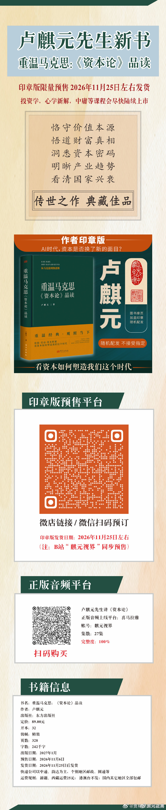

# 重温马克思：《资本论》品读（签章版）新书预售（@贾林州大河之南 帖 · 卢麒元附评转发）

> **发布方**：微博 @贾林州大河之南
> **原帖**：2026-11-07 13:58:53（ID 5362617607521302）
> **转发**：2026-11-07 16:11:54 · 微博 @卢麒元（ID 5362651087765559，附评「[鲜花]」）
> **互动**：转发 3 · 评论 8 · 赞 37（抓取时快照 16:16:02）
> **链接**：https://m.weibo.cn/detail/5362651087765559
> **配图**：转发对象配图 1 张（新书印章版预售海报，非文章插图），置于文末
> **归档时间**：2026-11-07（CST）

---

卢麒元附评：[鲜花]

@卢麒元 @正心以中and修身以和
先生新书：重温马克思：《资本论》品读（签章版）上线，欢迎预订，月底发货。
相比课程讲稿，新书中先生进一步系统梳理了大明灭亡与国家资管的关系，进一步阐述了向心坍缩和中美金融决战的基本结构和路径。。。
让我们燃一柱香，随先生一起慢慢品读这个美元危机爆发的世界[鲜花][鲜花][鲜花]

**附：微博原帖配图（非文章配图）**

［图注］系转发对象（@贾林州大河之南）随帖海报，非本文插图：竖版长图，卢麒元先生新书《重温马克思：〈资本论〉品读》印章版限量预售、2026年11月25日左右发货；含书籍立体封面、卖点文字、预售二维码与书籍信息（东方出版社、定价 89.00 元、32 开精装、328 页、242 千字）。来源：微博 @贾林州大河之南，2026-11-07 13:58:53。

*—— 注：卢麒元评论文逐字取自微博 show 端点 raw_text「[鲜花]」；转发对象正文按 ` ` 还原换行，结尾 3 个 [鲜花] 由 img alt 还原；图片取自转发对象 pics（large 尺寸）。*
