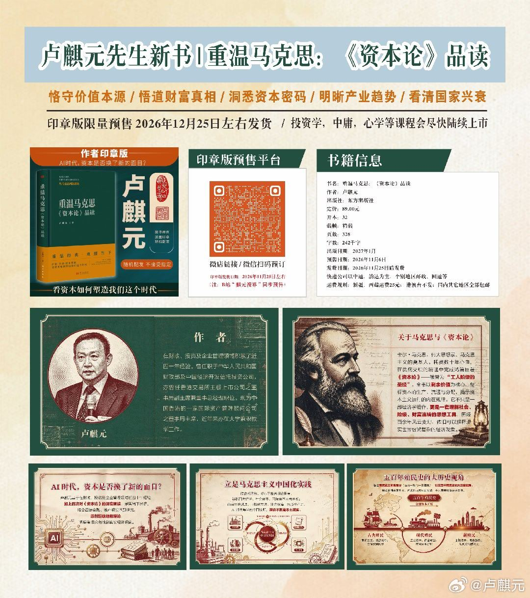

# 重温马克思：《资本论》品读 —— 马克思理论框架是研究经济问题的路径（@卢麒元 帖）

> **发布方**：微博 @卢麒元
> **发布**：2026-11-20 14:18:29 · 来源 华为Mate XT 非凡大师
> **互动**：转发 23 · 评论 24 · 赞 100（抓取快照 14:21:05）
> **链接**：https://m.weibo.cn/detail/5367333583324221
> **配图**：1 张（新书印章版预售长图，非文章插图），置于文末
> **归档时间**：2026-11-20（CST）

---

运用马克思的理论框架和分析方法，应是我国研究经济问题的路径之一。其中，第一卷价值论部分，其实是所有经济学的根基；第二卷和第三卷资本流转部分，其实是现代财政管理和金融管理的底层逻辑。资产和商品的定价理论与资本三流的数学模型，也是投资学的基本功。这本书是课件的整理，有缺憾，请见谅。

**附：微博原帖配图（非文章配图）**

［图注］系微博原帖随帖海报，非本文插图：卢麒元先生新书《重温马克思：〈资本论〉品读》印章版限量预售宣传图（1080×1218）——上方标语「恪守价值本源／悟道财富真相／洞悉资本密码／明晰产业趋势／看清国家兴衰」，左侧为书籍立体封面（「作者印章版」「AI时代，资本是否换了新面目？」），中部为微店二维码「印章版预售平台」，右侧书籍信息（东方出版社、定价 89.00 元、32 开精装、328 页、242 千字、出版日期 2027 年 1 月、预售日期 2026 年 11 月 6 日、2026 年 11 月 25 日后发货），下部为作者简介与「关于马克思与《资本论》」，底部三张主题卡片（AI时代资本、马克思主义中国化实践、五百年殖民史大历史视角）。来源：微博 @卢麒元，2026-11-20 14:18:29。

*—— 注：正文逐字取自微博 show 端点 text（该帖 raw_text 为空、无表情符号，仅去除 HTML 标签并 rstrip 尾部空格）；原帖无转发对象、非长文（isLongText=false，渲染页「展开全文／查看全文／查看更多／全文」计数均为 0）；配图取自 show 端点 pics 的 large 尺寸。*
