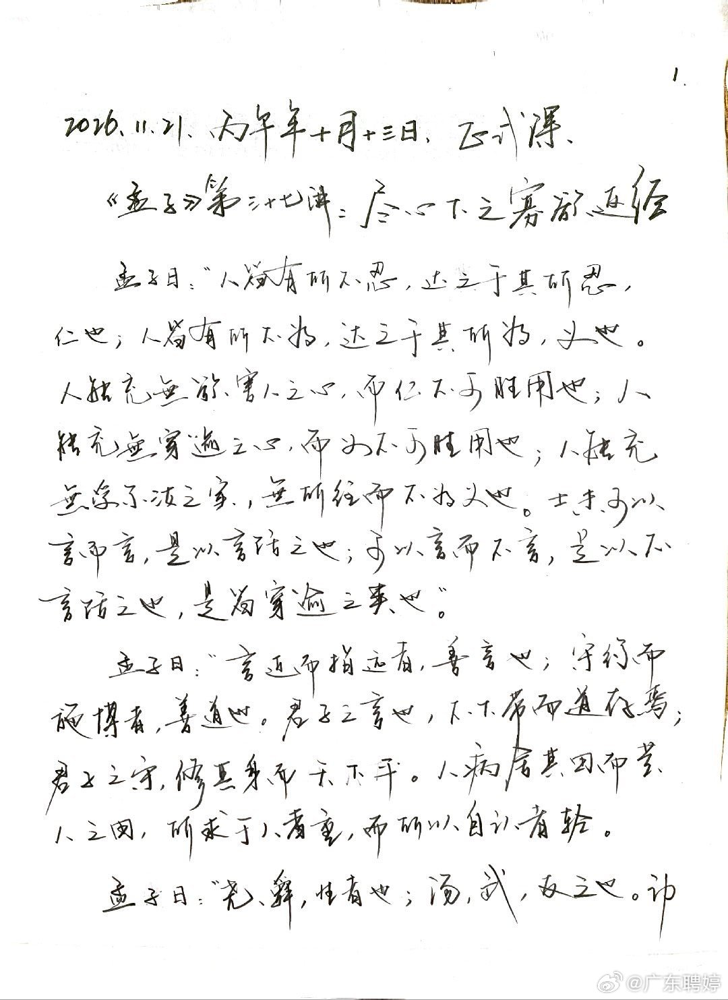
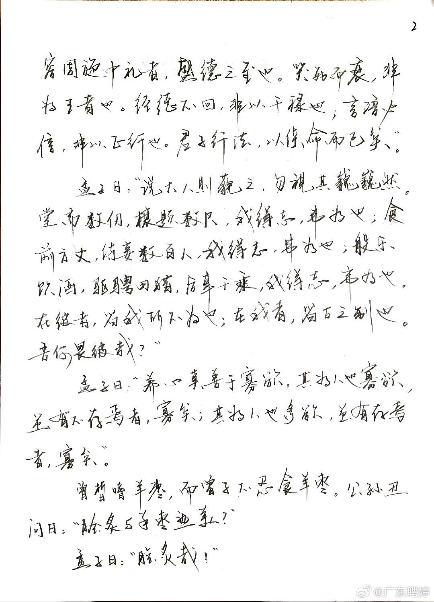
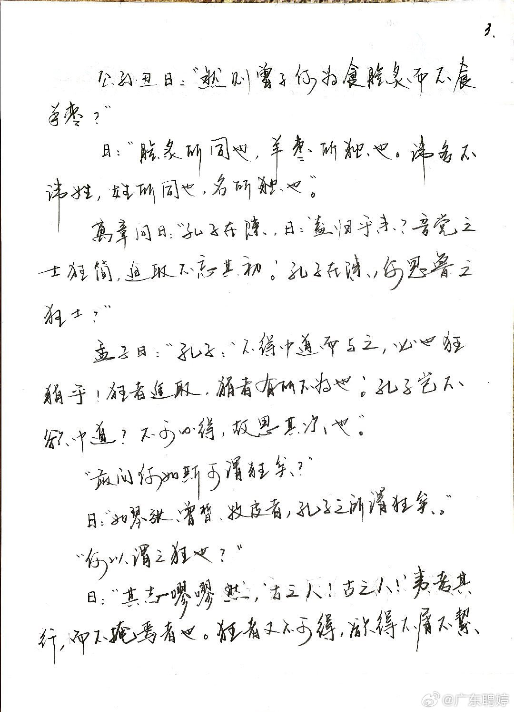
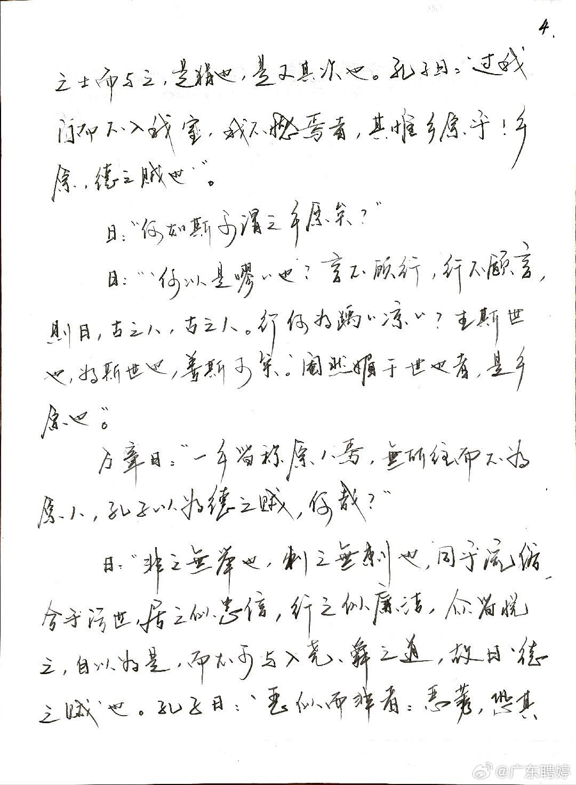
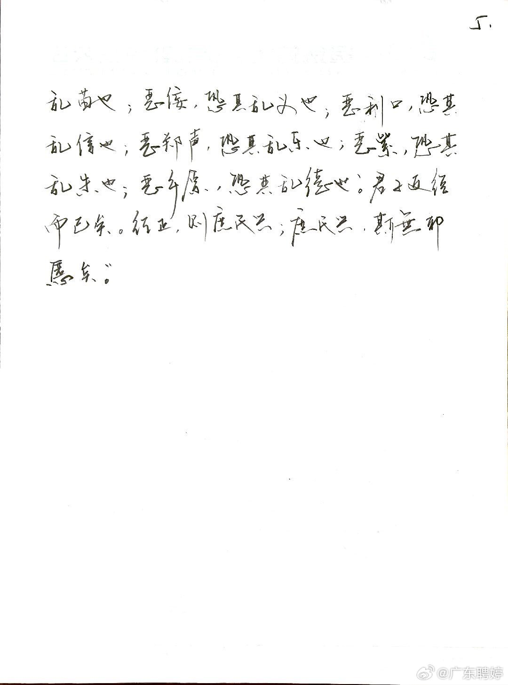

# 孟子第三十七讲：尽心下之寡欲返经（@广东聘婷 开课通知 · 卢麒元附评转发）

> **发布方**：微博 @广东聘婷
> **发布**：2026-11-18 17:01:08（ID 5366649742164404）
> **转发**：2026-11-19 12:48:47 · 微博 @卢麒元（ID 5366948621715145，附评论转发）
> **来源**：https://m.weibo.cn/detail/5366948621715145
> **配图**：转发对象配图 5 张（手写讲义），按原顺序置于正文之后
> **归档时间**：2026-11-19（CST）

---

**卢麒元附评**

周末要深究一下乡愿。也许，用佛家的语言更逼近圣人的本意。我想到了一个词：共业。在大历史叙事中，能从共业中走出来的非神既圣。将AI神化的叙事，何尝不是另一种乡愿。乡亲们总是被乡愿牵引，在共业里沉浮。辨识并出离乡愿，意味着觉醒和新生。这篇是非常有意思的。

**转发对象原文（@广东聘婷，2026-11-18 17:01:08）**

《孟子》第三十七讲：尽心下之寡欲返经[微笑]好开心周六快到了[鲜花][鲜花][鲜花]
开头就有所忍，有所不忍！期待课堂！！！

**转发对象配图（@广东聘婷 原帖，共 5 张手写讲义）**

［图注］转发对象配图（1/5），系 @广东聘婷 本条开课通知帖所附手写讲义图片（第 1 页）。来源：微博 @广东聘婷，2026-11-18 17:01:08。

［图注］转发对象配图（2/5），系 @广东聘婷 本条开课通知帖所附手写讲义图片（第 2 页）。来源：微博 @广东聘婷，2026-11-18 17:01:08。

［图注］转发对象配图（3/5），系 @广东聘婷 本条开课通知帖所附手写讲义图片（第 3 页）。来源：微博 @广东聘婷，2026-11-18 17:01:08。

［图注］转发对象配图（4/5），系 @广东聘婷 本条开课通知帖所附手写讲义图片（第 4 页）。来源：微博 @广东聘婷，2026-11-18 17:01:08。

［图注］转发对象配图（5/5），系 @广东聘婷 本条开课通知帖所附手写讲义图片（第 5 页）。来源：微博 @广东聘婷，2026-11-18 17:01:08。

*—— 注：卢麒元帖文逐字取自微博 show 端点 raw_text（无表情，与 extend、渲染页两副本一致）；转发对象原文取自 show 端点 text 字段（raw_text 为空，表情按 img alt 还原：[微笑]×1、[鲜花]×3，` ` 还原为换行，结尾空格略去）。图片取自 @广东聘婷 原帖 pics（large 尺寸），按原顺序嵌入。*
