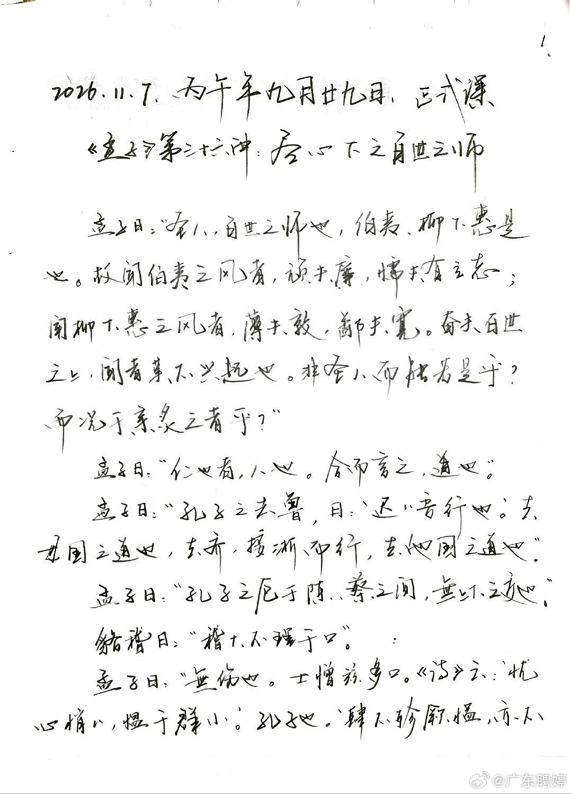
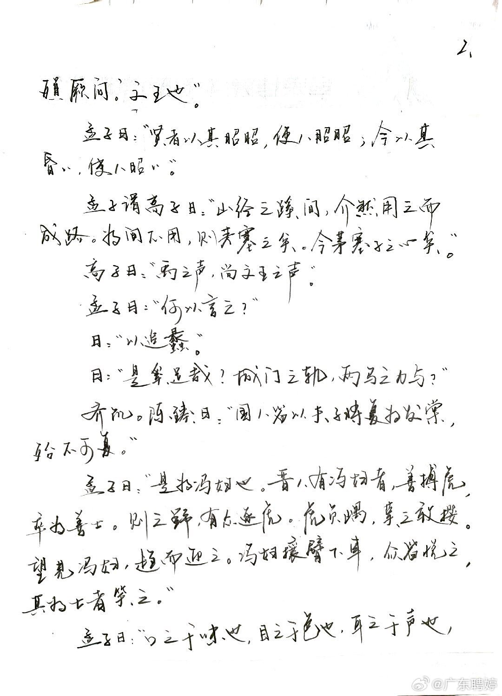
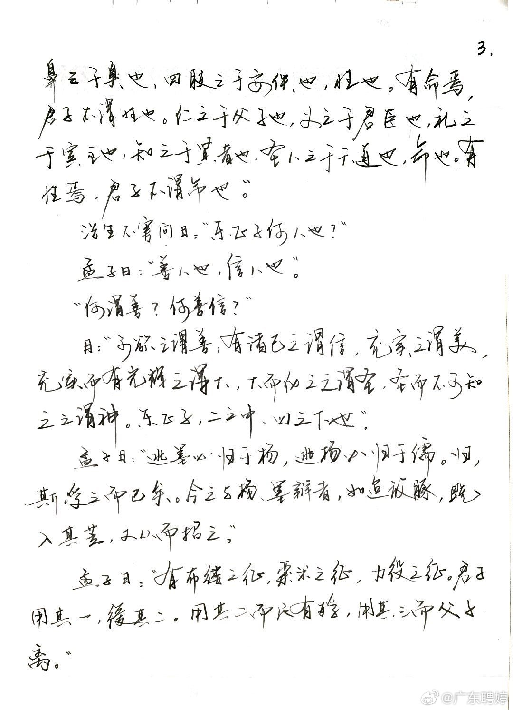
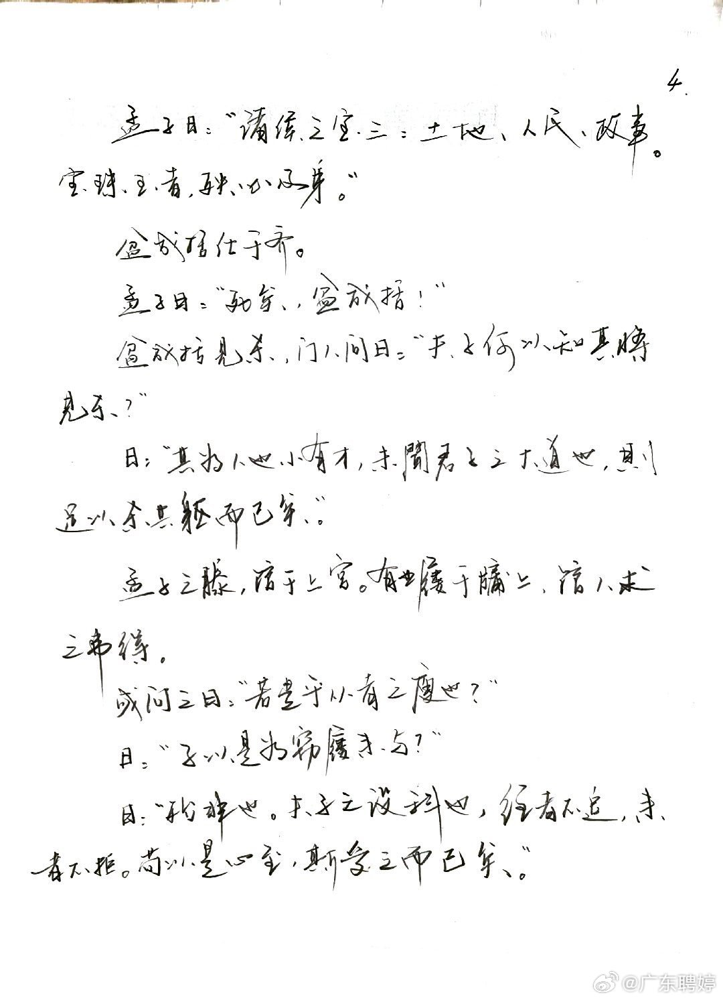

# 孟子第三十六讲：尽心下之百世之师（@广东聘婷 开课通知 · 卢麒元、正心以中转发）

> **发布方**：微博 @广东聘婷
> **发布**：2026-11-06 13:00:14（ID 5362240458853950）
> **转发**：2026-11-06 13:17:21 · 微博 @卢麒元（ID 5362244772692727，纯转发、无附加评论）
> **转发（二次）**：2026-11-06 16:09:44 · 微博 @正心以中and修身以和（ID 5362288152545772，纯转发、无附加评论）
> **来源**：https://m.weibo.cn/detail/5362244772692727
> **配图**：转发对象配图 4 张，按原顺序置于正文之后
> **归档时间**：2026-11-06（CST）

---

《孟子》第三十六讲，尽心下之百世之师！圣人可做百世之师！先生辛苦！

**转发对象配图（@广东聘婷 原帖，共 4 张）**

［图注］转发对象配图（1/4），系 @广东聘婷 本条开课通知帖所附图片。来源：微博 @广东聘婷，2026-11-06 13:00:14。

［图注］转发对象配图（2/4），系 @广东聘婷 本条开课通知帖所附图片。来源：微博 @广东聘婷，2026-11-06 13:00:14。

［图注］转发对象配图（3/4），系 @广东聘婷 本条开课通知帖所附图片。来源：微博 @广东聘婷，2026-11-06 13:00:14。

［图注］转发对象配图（4/4），系 @广东聘婷 本条开课通知帖所附图片。来源：微博 @广东聘婷，2026-11-06 13:00:14。

*—— 注：帖文逐字取自微博 show 端点 text 字段（raw_text 为空、无表情），按微博端原样保留结尾空格前内容；图片取自 @广东聘婷 原帖 pics（large 尺寸），按原顺序嵌入。*
